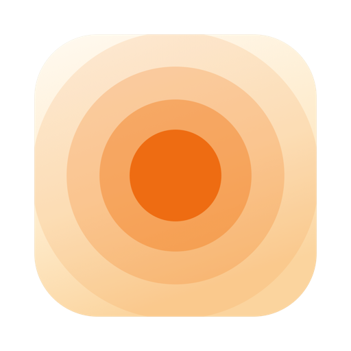
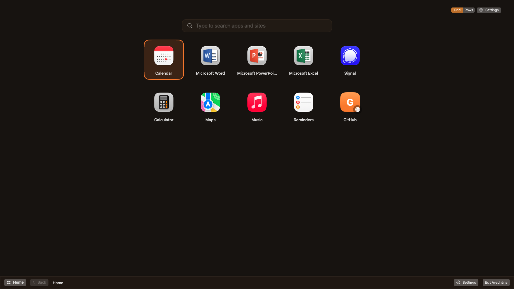

<!-- Header block for project -->
<hr>

<div align="center">



<h1 align="center">Avadhāna</h1>

</div>

<pre align="center">A calm, full-screen macOS launcher that shows only the apps and websites you choose, one at a time.</pre>

<!-- Header block for project -->

[](LICENSE) [](https://github.com/riverma/avadhana/releases/latest)  [](https://nasa-ammos.github.io/slim/)



*Avadhāna* (अवधान) is Sanskrit for attention, concentration. A computer puts the entire world one click away: every app, every site, every notification, from anything and anywhere, can reach you. Avadhāna is for anyone who wants to choose more intentionally what reaches them and where their attention goes. You choose the few apps and websites that matter, and use them one at a time, full screen, with nothing else on view.

[Website](https://avadhana.riverma.com) | [Download](https://github.com/riverma/avadhana/releases/latest) | [Issue Tracker](https://github.com/riverma/avadhana/issues)

## Features

* **Only what you choose.** While Avadhāna is on, apps that aren't on your list are closed when opened (from the Dock, Spotlight or a link), and apps that were already open are hidden, never quit.
* **One thing at a time.** Each app or site fills the screen. The Dock and menu bar step aside, and a bar at the bottom offers Home, Back and Exit.
* **Websites without the detours.** Sites open with no address bar or tabs in Safari (WebKit), Firefox or Chrome, using a profile separate from your normal browser. With Safari, links outside a site's allowed domains don't open.
* **Keyboard friendly.** Type to search; arrow keys, Page Up/Down, Home and End to move; Return to open. Home (⌘Esc) and Back (⌃⌘⌫) work in every app and can be changed or turned off.
* **Grid or rows**, arranged by dragging or from a tile's right-click menu.
* **Exit any time.** Logging out, restarting or shutting down is never blocked.
* **Private.** No accounts, analytics or network features of its own.

## Contents

* [Quick Start](#quick-start)
* [Changelog](#changelog)
* [FAQ](#frequently-asked-questions-faq)
* [Contributing Guide](#contributing)
* [License](#license)
* [Support](#support)

## Quick Start

This guide provides a quick way to get started with Avadhāna. See the [website](https://avadhana.riverma.com) for a more general overview.

### Requirements

* macOS 14 Sonoma or later, on Apple silicon or Intel
* Optional: Firefox or Google Chrome, if you'd rather open sites in one of them than in Safari
* To build from source: Xcode 16 or later (Swift 6 toolchain)

### Setup Instructions

1. Download `Avadhana.dmg` from the [latest release](https://github.com/riverma/avadhana/releases/latest).
2. Open it and drag **Avadhāna** into **Applications**.
3. Open Avadhāna and allow **Accessibility** access when asked (System Settings → Privacy & Security → Accessibility). It's used to size app windows to fill the screen and to track the browser windows Avadhāna opens.

### Run Instructions

1. Open **Settings** (⌘,). Check the apps you want on the **Apps** tab, add websites on the **Sites** tab, and pick a web browser on **General**.
2. In the main window, choose grid or rows and arrange the tiles.
3. Click **Start Avadhāna**. The home screen fills the display with just your tiles.
4. When you're done, click **Exit Avadhāna** in the bottom bar (or press ⌘Q). The Dock comes back and the apps you had open reappear.

### Usage Examples

* **Writing session:** add your editor and a reference site such as MDN; open each from the home screen and switch with Home (⌘Esc).
* **Staying on one website:** add a site with Safari as the browser and list its allowed domains (for example `github.com, githubusercontent.com`). Links elsewhere won't open.
* **Your own keys:** Settings → Shortcuts lists every shortcut. Record new keys, turn any off, or set Home/Back to "Ignore while typing" to keep keys like ⌘⌫ working in text fields.

Settings are stored in `~/Library/Application Support/Avadhana/config.json`, which you can also edit by hand (changes are picked up when Avadhāna starts).

### Build Instructions

1. Clone the repository:
   ```sh
   git clone https://github.com/riverma/avadhana.git
   cd avadhana
   ```
2. Build and open the app (a universal binary in `build/Avadhana.app`):
   ```sh
   ./build.sh
   open build/Avadhana.app
   ```
   `build.sh` signs with a Developer ID Application certificate if you have one, otherwise an Apple Development certificate, otherwise ad hoc. macOS ties Accessibility access to the signature, so ad hoc builds need it granted again after each build. The app icon is drawn in `Resources/AppIcon.svg` and rendered by `scripts/make-icon.swift`.
3. Optional: `./package-dmg.sh` packages `build/Avadhana.dmg` for local testing.
4. Releasing (maintainers): `./notarize.sh` builds with a Developer ID, packages the DMG, notarizes it with Apple and staples the ticket. One-time setup is described at the top of the script. Attach `build/Avadhana.dmg` to a GitHub release; the website's download button always points to the latest release's `Avadhana.dmg`. Only notarized builds should be published.

The website lives in `docs/` and is served by GitHub Pages at [avadhana.riverma.com](https://avadhana.riverma.com).

### Test Instructions

1. Run the unit tests (site address validation, allowed domains, settings loading, tile order, shortcut matching):
   ```sh
   swift test
   ```
   They also run on every push and pull request via GitHub Actions.
2. Check the parts that depend on macOS itself by hand:

   1. Run `./build.sh` and open `build/Avadhana.app`; Settings → General shows the version and the git commit it was built from.
   2. Add an app and a site, then click **Start Avadhāna**. Open each tile; it should fill the screen above the bottom bar.
   3. Open an app that isn't on your list from Spotlight; it should close and a message should explain why.
   4. Press ⌘Esc and ⌃⌘⌫ inside another app; they should go Home and Back.
   5. Click **Exit Avadhāna** and choose **Exit**; the Dock and previously open apps should come back.

## Changelog

See our [CHANGELOG.md](CHANGELOG.md) for a history of our changes.

See our [releases page](https://github.com/riverma/avadhana/releases) for our key versioned releases.

## Frequently Asked Questions (FAQ)

1. Why does Avadhāna need Accessibility access?
   - macOS only lets an app resize other apps' windows with this permission. Avadhāna doesn't record what you type or what's on screen, and sends nothing anywhere.
2. Will it change my browser or my Mac's settings?
   - Sites open in a separate browser profile, so your normal browser settings, bookmarks and history aren't touched. The Dock is hidden while Avadhāna is on; its original settings are saved first and restored when you exit, or on the next launch if the app quits unexpectedly.
3. Is it on the Mac App Store?
   - No. App Store apps must be sandboxed, and the sandbox doesn't allow managing other apps' windows. Releases are signed with a Developer ID and notarized by Apple.
4. What are the current limitations?
   - Avadhāna manages the main display; other displays stay usable. Allowed domains are enforced when sites open in Safari; in Firefox and Chrome, links can lead to other sites.

## Contributing

1. Create a GitHub [issue](https://github.com/riverma/avadhana/issues) describing the change you'd like to make.
2. [Fork](https://github.com/riverma/avadhana/fork) this repository.
3. Make your changes in your fork and check them with the [test instructions](#test-instructions) above.
4. Open a pull request in this repository, linking the issue, and tag the repository owner as a reviewer.

**Working on your first pull request?** See guide: [How to Contribute to an Open Source Project on GitHub](https://kcd.im/pull-request)

## License

Avadhāna is free software, licensed under the GNU Affero General Public License v3.0. See our: [LICENSE](LICENSE)

## Support

Key point of contact: [@riverma](https://github.com/riverma) (Rishi Verma, [riverma.com](https://riverma.com)). Questions and bug reports are welcome in the [issue tracker](https://github.com/riverma/avadhana/issues).

If Avadhāna helps you, you can [donate](https://buy.stripe.com/9B6eVe8Gf4Bt21I6HFgrS00) to support its development.
